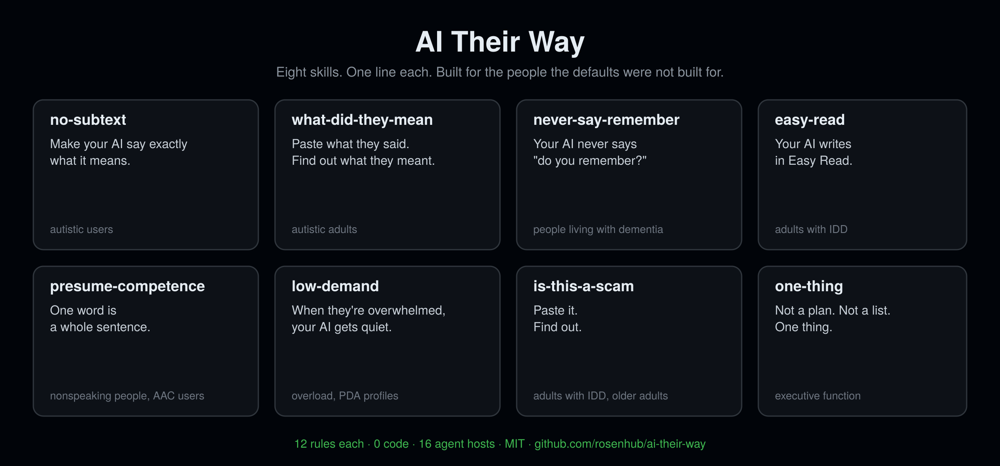

<div align="center">

# AI Their Way

### Skills that make any AI agent work for autistic, IDD, and dementia users.

**8 skills. 0 code. Install any of them in 10 seconds. Built for the people the defaults were not built for. Better for everyone.**

[](LICENSE)
[](#the-skills)
[](#install)
[](#the-skills)

**让任何 AI 代理为自闭症、智力与发育障碍、失智症用户服务的技能合集。**

[The skills](#the-skills) · [Which one do I need?](#which-one-do-i-need) · [Install](#install) · [Stack them](#stack-them) · [Why](#why-this-exists) · [FAQ](#faq)

```bash
curl -fsSL https://raw.githubusercontent.com/rosenhub/ai-their-way/main/install-all.sh | sh
```



</div>

---

Every AI assistant ships with one personality: cheerful, hedging, idiom-heavy, answer-in-paragraph-three. That default was tuned on the median user. It fails hardest for the people who notice it first: autistic adults who take language literally, adults with IDD who need one idea per sentence, people with dementia who ask the same question again and are told "I already said that," nonspeaking people whose one-word message gets three clarifying questions back.

Each skill here is one markdown file that fixes one of those failures. They install into Claude Code, Codex, Cursor, Gemini CLI, ChatGPT, OpenClaw, and 10 other hosts. They stack. They are MIT. None of them is a clinical tool.

## The skills

| Skill | One line | Built for | Install |
|---|---|---|---|
| [**no-subtext**](https://github.com/rosenhub/no-subtext) | Make your AI agent say exactly what it means. | autistic users | `npx skills add rosenhub/no-subtext` |
| [**what-did-they-mean**](https://github.com/rosenhub/what-did-they-mean) | Paste what they said. Find out what they meant. | autistic adults | `npx skills add rosenhub/what-did-they-mean` |
| [**never-say-remember**](https://github.com/rosenhub/never-say-remember) | Your AI never says "do you remember?" | people living with dementia | `npx skills add rosenhub/never-say-remember` |
| [**easy-read**](https://github.com/rosenhub/easy-read) | Your AI writes in Easy Read. | adults with IDD | `npx skills add rosenhub/easy-read` |
| [**presume-competence**](https://github.com/rosenhub/presume-competence) | One word is a whole sentence. | nonspeaking autistic people, AAC users | `npx skills add rosenhub/presume-competence` |
| [**low-demand**](https://github.com/rosenhub/low-demand) | When they're overwhelmed, your AI gets quiet. | autistic people in overload, PDA profiles | `npx skills add rosenhub/low-demand` |
| [**is-this-a-scam**](https://github.com/rosenhub/is-this-a-scam) | Paste it. Find out. | adults with IDD, older adults | `npx skills add rosenhub/is-this-a-scam` |
| [**one-thing**](https://github.com/rosenhub/one-thing) | Not a plan. Not a list. One thing. | executive-function differences | `npx skills add rosenhub/one-thing` |

Every skill has the same shape: 12 rules, a before/after, a 16-host install table, a 48-prompt benchmark with an LLM judge and a deterministic lint, and a "what this is not" section. If you've read one, you can read all of them in five minutes.

## Which one do I need?

By situation, not by diagnosis. Diagnoses don't tell you how someone communicates; the situation does.

| The problem you're seeing | Start with |
|---|---|
| The answer is buried, hedged, or wrapped in "Great question!" | **no-subtext** |
| "You might want to consider" and they didn't realize it was an instruction | **no-subtext** |
| They got a message from a person and can't tell what it means or what's expected | **what-did-they-mean** |
| They ask the same thing again and the AI says "as I mentioned" | **never-say-remember** |
| The AI corrects them about what year it is, or who's alive | **never-say-remember** |
| Paragraphs too long, words too hard, no examples | **easy-read** |
| They type one word and get three questions back | **presume-competence** |
| The AI corrects their spelling or asks for "a full sentence" | **presume-competence** |
| They're melting down and the AI is offering a 6-step self-care plan | **low-demand** |
| Someone online wants gift cards and says don't tell anyone | **is-this-a-scam** |
| They've been avoiding a task for months and the AI gave them a 9-step plan | **one-thing** |

## Install

### All of them, or pick

```bash
curl -fsSL https://raw.githubusercontent.com/rosenhub/ai-their-way/main/install-all.sh | sh
```

The script lists the eight skills, lets you pick (or `--all`), and runs each skill's own installer. Each installer finds the agent hosts on your machine and installs into every one. Nothing else is touched.

```bash
# non-interactive examples
curl -fsSL .../install-all.sh | sh -s -- --all
curl -fsSL .../install-all.sh | sh -s -- no-subtext one-thing
curl -fsSL .../install-all.sh | sh -s -- --all --project   # also into the current repo
```

### One at a time

```bash
npx skills add rosenhub/<skill>
```

### By hand

Each skill is a single `SKILL.md`. The install table in each repo says where it goes for your host:

| Host | Location |
|---|---|
| Claude Code | `~/.claude/skills/<skill>/SKILL.md` |
| Claude.ai / Desktop | Project instructions, or Settings → Styles |
| Codex CLI | append to `AGENTS.md` |
| Cursor | `.cursor/rules/<skill>.mdc` |
| Windsurf | `.windsurf/rules/<skill>.md` |
| Gemini CLI | append to `GEMINI.md` |
| OpenCode · Amp | append to `AGENTS.md` |
| Cline | `.clinerules/<skill>.md` |
| Roo Code | `.roo/rules/<skill>.md` |
| GitHub Copilot | append to `.github/copilot-instructions.md` |
| Aider | append to `CONVENTIONS.md` |
| Kiro | `.kiro/steering/<skill>.md` |
| OpenClaw | `~/.openclaw/skills/<skill>/SKILL.md` |
| ChatGPT | Settings → Personalization → Custom instructions |

## Stack them

They were written to coexist. Each one changes a different thing.

| Combination | What you get |
|---|---|
| **no-subtext + one-thing** | Direct answers, one action at a time. The executive-function stack. |
| **no-subtext + what-did-they-mean** | Subtext removed from the AI; subtext decoded from humans. The autistic-adult stack. |
| **never-say-remember + low-demand** | Never corrected, never pushed. The dementia-care stack. |
| **easy-read + is-this-a-scam** | Plain language and a scam check in the same chat. The IDD independence stack. |
| **presume-competence + low-demand** | One word is enough; silence is fine. The nonspeaking stack. |

What doesn't stack: **easy-read** and **what-did-they-mean** pull in opposite directions (one shortens, one explains at length). Pick one per conversation.

Install order doesn't matter. If two rules ever conflict, the later-installed skill wins in most hosts; in practice the only overlap is "no idioms," which they all agree on.

## Why this exists

I build AI for autistic adults and people with IDD, and I've spent two years watching the same thing happen: the person says exactly what's wrong with the chatbot, in precise words, and nobody writes it down. "It buries the answer." "It asks me three things at once." "It told me it already said that." "It gave me a plan when I asked for help."

Those are not autism problems or dementia problems. They are default-personality problems that certain people notice first. This is the curb-cut effect: the ramp built for wheelchairs is used by everyone with a stroller. Every skill here was written for a specific group and every one of them makes the agent better for the median user too.

The rules came from users, from support staff, from parents, and from the communication research each community has already done (Easy Read is a standard; "presume competence" is the nonspeaking community's own phrase; "low demand" is from the PDA community). I wrote them down and made them installable.

## What this is not

Not clinical. Not a substitute for a human. Not a monitoring tool. Not a guarantee. If someone is in danger, the skills say so once, plainly, and point to a human — the rest is up to the humans.

## Benchmarks

Every skill ships with `eval/`: 48 prompts across 8 categories, a rubric that is the skill's own self-check, an LLM judge, and a deterministic lint that needs no API key. `python eval/run.py --model <model>` runs the skill on and off and reports the delta per category. The methodology is public so the argument can be about the numbers.

Results are collected in each repo's `eval/results/`. Post yours.

## Who made this

Josh Rosenfeld. I build AI for autistic adults and people with intellectual and developmental disabilities — [AlwaysHere](https://alwayshere.app), a voice companion; the tech behind [Find Love Safely](https://findlovesafely.com), [InControl](https://incontrolmn.com) and [CCHI](https://thecchi.org); and AI trainings for parents and professionals around the US. Before that, 30 years of UX, including the design system for ShowingTime (Zillow).

These skills are the communication layer of [Guardian](https://guardian.alwayshere.app), the paid product, open-sourced. Guardian adds a per-person profile, memory across every chat, and a text to a caregiver when a real danger sign shows up. If you only need the agent to talk right, the skills are enough. If you're setting it up for someone else, that's Guardian.

## FAQ

<details>
<summary><b>Do I need to be autistic / have IDD / have dementia to use these?</b></summary>

No. The framing is about who noticed first, not who it's for. Install no-subtext for a day and see.
</details>

<details>
<summary><b>Can I install all eight?</b></summary>

Yes, but you probably don't want to. See [Stack them](#stack-them). Two or three per person is typical.
</details>

<details>
<summary><b>Are these clinical tools?</b></summary>

No. None of them diagnose, treat, or monitor. They change how an AI talks. Each repo says what it is not.
</details>

<details>
<summary><b>Can I use these in my product?</b></summary>

Yes. MIT. Copy the file into your system prompt. Attribution appreciated, not required.
</details>

<details>
<summary><b>I think a rule is wrong.</b></summary>

Open an issue on that skill's repo with a real before/after. If you're in the community the skill is for, say so — your experience is the evidence.
</details>

<details>
<summary><b>Is there one for [group]?</b></summary>

Not yet, probably. Open an issue here with the one sentence the group keeps saying about chatbots. That sentence is usually the whole skill.
</details>

## Contributing

- A new skill needs: a group, the one sentence they keep saying, 12 rules, a before/after, and a benchmark. Fork a sibling and follow its shape. See [CONTRIBUTING.md](CONTRIBUTING.md).
- Translations: each repo takes `README.<lang>.md`.
- Hosts: if your agent reads markdown instructions from a file and isn't in the table, open an issue with the path.

## Star history

<a href="https://star-history.com/#rosenhub/ai-their-way&rosenhub/no-subtext&rosenhub/never-say-remember&rosenhub/easy-read&Date">
  
</a>

## License

MIT.
